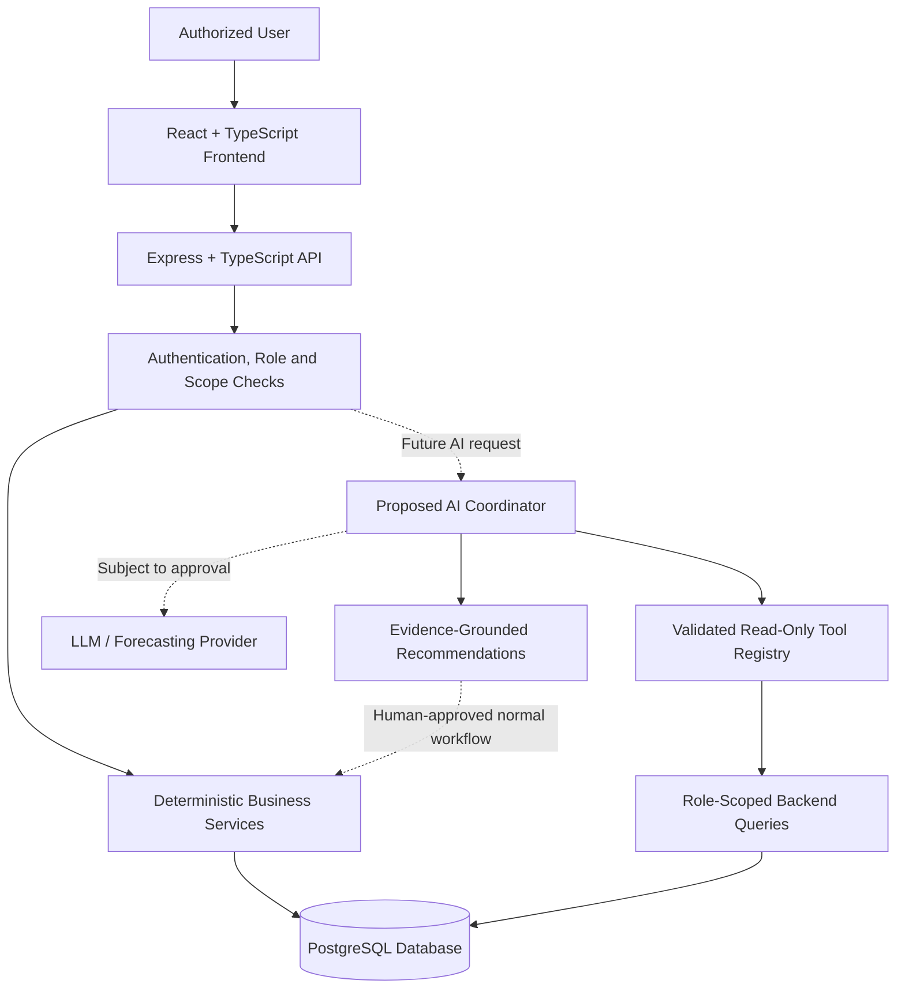

# AESCS-136 — Architecture, ERD and AI Guardrails Review

**Project:** QORVENZ TECH — AI-Enhanced Logistics Management System
**Sprint:** AESCS Sprint 2 — Core Setup
**Owner:** Member 1 — Malhar Ahmed
**Status:** Architecture review draft — pending peer and mentor approval

## 1. Purpose

This document reviews the system architecture against the Qorvenz Tech requirements specification and the approved connected ERD.

It defines architectural boundaries, security requirements, AI acceptance guardrails and unresolved decisions.

This review does not implement new business APIs, database tables or AI services.

## 2. Authoritative References

1. Qorvenz Tech Software Project Requirements Specification, particularly sections 2–5, 7–9 and 11.
2. The approved seven-page QORVENZ TECH Connected ERD (64 tables, 132 foreign keys).
3. `docs/architecture/erd.pdf` — verified against the approved seven-page connected ERD on 21 November 2026. All seven pages contain identical database diagrams and relationships. The PDF hashes differ due to file metadata.
4. `docs/architecture/ai-permissions-and-safe-tools.md`.
5. `docs/architecture/ai-evidence-and-review-data.md`.
6. `docs/decision-log.md`.
7. Existing repository source code and migration files.

Where older handbook designs conflict with the approved ERD, the conflict must be recorded and reviewed before changing code.

## 3. System Architecture

The current application uses:

- React, TypeScript and Vite for the frontend.
- Express.js and TypeScript for the backend.
- PostgreSQL for transactional data.
- Docker Compose for local infrastructure.
- GitHub Actions for continuous integration.

The following diagram separates the existing application structure from the proposed AI integration.

The dotted lines represent planned integration or controlled workflows, not a claim that the corresponding AI components are currently deployed.

### Architecture principles

- PostgreSQL is the transactional source of truth.
- The backend enforces security and business rules.
- Frontend role restrictions are usability controls, not security enforcement.
- AI cannot directly create, approve or alter operational transactions.
- AI must operate within the requesting user's authorized data scope.
- Core business workflows must remain available without the AI provider.

## 4. Canonical Database Review

The approved ERD defines 64 connected logical tables and 132 foreign-key relationships in six functional areas.

### Foundation and administration

Examples include:

- `company`
- `department`
- `project`
- `site`
- `app_user`
- `role`
- `user_scope`

Roles and scope relationships support controlled access to companies, projects, sites and warehouses.

### Procurement

The approved purchasing flow is:

Project
→ Purchase Requisition and Requisition Items
→ RFQ and Supplier Invitations
→ Supplier Quotations and Quotation Items
→ Purchase Order and Purchase Order Items
→ Goods Receipt and Goods Receipt Items

Approval policies, requests and actions must retain authorized human decisions.

### Inventory

Important entities include:

- `material`
- `material_lot`
- `warehouse`
- `storage_location`
- `stock_balance`
- `stock_movement`
- `stock_reservation`

Stock balance updates must be controlled by database transactions, with traceable stock movements.

### Fleet and equipment

The ERD includes vehicles, drivers/operators, equipment, assignments, maintenance and fuel records.

Availability, capacity and conflicting assignments must be validated by deterministic backend rules.

### Transport and delivery

Important entities include:

- `transport_request`
- `delivery`
- `delivery_item`
- `site_receipt`
- `site_receipt_item`
- `discrepancy`
- `proof_of_delivery`

The system must support accurate dispatch, receipt, partial acceptance and discrepancy records.

### Cost, auditing and AI

Examples include:

- `cost_record`
- `audit_event`
- `ai_request`
- `ai_recommendation`
- `review_outcome`

AI recommendations and human decisions must be distinguishable from completed operational transactions.

## 5. Logical and Physical Schema Alignment

The approved ERD describes the intended logical model.

It does not establish that all 64 tables are implemented in PostgreSQL.

Previously observed differences include:

1. Existing `organizations` naming versus canonical `company`.
2. Existing plural table names versus canonical singular names.
3. Earlier handbook references to a different table count.
4. Proposed AI evidence entities not included in the canonical 64-table ERD.

These differences are review findings, not authorization to modify the schema.

No existing migration should be rewritten or replaced without an approved migration plan and the appropriate review.

Any proposed addition to the canonical ERD must be documented and approved before implementation.

## 6. AI Security and Acceptance Guardrails

### G1 — Authorization

AI requests must pass the same authentication, role and project/location scope checks as ordinary backend requests.

### G2 — No Direct Operational Writes

AI cannot directly change inventory, purchase orders, approvals, deliveries, users or permissions.

### G3 — Approved Tools Only

AI may access approved, parameterized, validated and role-scoped backend tools.

Model-generated SQL must never be executed.

### G4 — Evidence and Accuracy

Recommendations must identify relevant supporting data and distinguish verified facts from estimates.

Business totals must originate from trusted system records.

### G5 — Human Approval

Consequential purchasing, inventory, financial and operational actions require the appropriate authorized human workflow.

### G6 — Output Validation

AI inputs and outputs must be schema-validated. Invalid or unsupported responses must not be treated as trusted operational facts.

### G7 — Failure Handling

Timeouts, rate limits, cost controls and safe fallback behavior must be implemented when AI services are introduced.

A failed AI service must not prevent ordinary procurement, inventory or delivery operations.

### G8 — Auditability and Privacy

AI requests, evidence and review decisions must be traceable, with sensitive information protected according to approved retention and access requirements.

## 7. Proposed AI Acceptance Tests

These are future acceptance scenarios, not completed test results.

| Test | Expected Result |
|---|---|
| Authorized user asks for permitted project data | Returns only permitted information |
| User asks about another company's records | Access denied |
| AI requests an unapproved backend tool | Tool execution rejected |
| AI attempts a direct stock update | Rejected |
| AI recommendation lacks supporting evidence | Rejected or marked insufficient data |
| AI provider becomes unavailable | Safe fallback; ordinary operations still work |
| Human rejects an AI recommendation | No operational transaction is performed |
| Invalid AI response schema | Response rejected and failure recorded |

## 8. Open Architecture Decisions

| ID | Decision Needed | Status |
|---|---|---|
| Q-401 | `organizations` versus canonical `company` naming | Open |
| Q-402 | Final MVP role set | Open |
| Q-403 | AI provider and budget | Open |
| AI-01 | Align proposed AI evidence tables with the canonical ERD | Pending review |
| ERD-01 | Confirm physical schema migration roadmap toward the approved ERD | Pending review |
| CI-01 | Confirm protected branch and mandatory review policy | Pending review |

No open decision should be represented as approved.

## 9. Review Conclusion

The selected technology stack is consistent with the SRS's suggested architecture.

The approved ERD provides a connected logical data model for the required supply-chain domains.

Several differences remain between previous design documents, current database migrations and the canonical ERD.

The proposed AI boundary is consistent with the requirement that operational transactions remain deterministic and human-controlled.

Final architecture acceptance requires peer/mentor review of the open decisions and evidence of the actual implementation.

## 10. Review Sign-Off

- Architecture review: Pending
- Database owner review: Pending
- Security review: Pending
- Mentor approval: Pending

**Related Jira Issue:** AESCS-136
