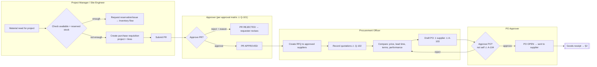
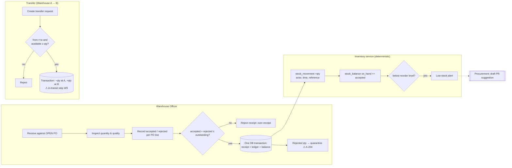
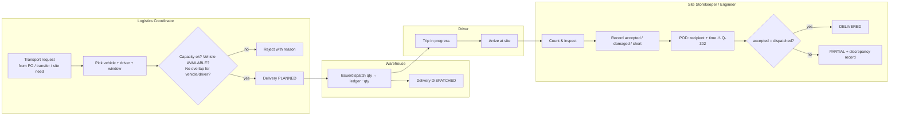
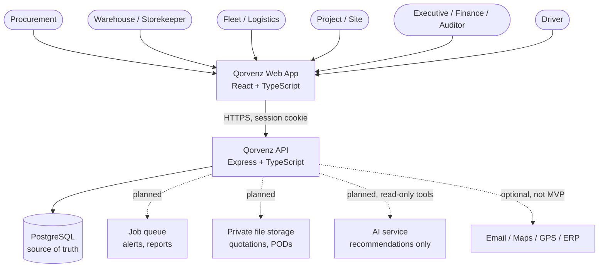

# 03 — Process Swimlanes, Context Diagram & Candidate Architecture

**Cards:** QOR-01-03-M1 (PR→PO) · QOR-01-03-M2 (receipt→stock→transfer) · QOR-01-03-M3 (transport→site acceptance) · QOR-01-03-M4 (context, user map, architecture)
**Status:** Drafted, awaiting peer review. The diagrams are Mermaid, so they render on GitHub and in VS Code with the Mermaid extension.

Steps marked ⚠ depend on an OPEN assumption or question from the decision log.

---

## 1. PR → PO workflow and approval swimlane (Member 1)

**State model (proposed)**

| Entity | States | Allowed transitions |
| :--- | :--- | :--- |
| Requisition | DRAFT → SUBMITTED → APPROVED / REJECTED; APPROVED → PARTIALLY_ORDERED → ORDERED → CLOSED; any pre-order state → CANCELLED | Only the approver may APPROVE or REJECT. The requester may not approve their own PR. |
| Purchase order | DRAFT → PENDING_APPROVAL → OPEN → PARTIAL → COMPLETE; OPEN → CANCELLED (if nothing has been received) | Only the PO approver approves. Amendments ⚠ Q-103. |

---

## 2. Receipt → stock → transfer swimlane (Member 2)

**Invariants:** `on_hand ≥ 0`, `0 ≤ reserved ≤ on_hand`, and every balance change has exactly one ledger row. A transfer source can never equal its destination. Writes are idempotent through a request key.

---

## 3. Transport → site acceptance swimlane (Member 3)

---

## 4. System context diagram (Member 4)

## 5. User map

| User group | Primary jobs in MVP | Main screens |
| :--- | :--- | :--- |
| System Administrator | Users, roles, scopes, configuration | Settings, Team |
| Procurement Officer / Manager | PR review, RFQ, quotations, PO | Procurement |
| Warehouse Manager / Officer | Receipt, stock, transfer, count | Inventory |
| Site Storekeeper / Project Manager | Request materials, receive deliveries | Overview, Deliveries |
| Logistics Coordinator / Fleet Manager | Plan transport, assign vehicles, maintenance | Deliveries, Fleet |
| Driver | Today's trips, POD | Driver dashboard |
| Executive / Finance / Auditor | Dashboards, reports, read-only audit | Overview, Analytics |

> The current frontend implements three roles (Admin, Warehouse manager, Driver). The mapping to the SRS roles is open: see decision log Q-402.

## 6. Candidate architecture

| Layer | Choice | Status in repo |
| :--- | :--- | :--- |
| Web | React 18 + Vite + TypeScript (`frontend/`) | Exists: login, signup, role dashboards (mock data) |
| API | Express + TypeScript (`apps/api/`) | Exists: health, auth (session cookie, bcrypt, rate limit) |
| DB | PostgreSQL 16 (`database/migrations/`) | Exists: 6 tables (`001_sprint1_foundation.sql`) |
| Modules | `modules/procurement`, `inventory`, `logistics`, `agents` | **Not yet.** Planned from Sprint 2/3 |
| Jobs / files / AI | BullMQ, object storage, LLM adapter | Planned (Sprints 8–10) |
| CI | GitHub Actions: lint, typecheck, test, build | Exists |
